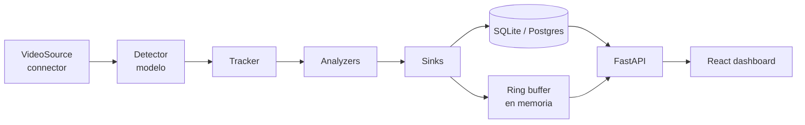

# Arquitectura

<!-- Se carga en cualquier tarea que toque el pipeline, un connector, un detector o un
     analizador. Es el documento que define los límites entre bloques. -->

La regla de oro: **cada bloque es un `Protocol` y todo lo que lo implementa se registra por
nombre**. Un proyecto nuevo es un fichero YAML, no código nuevo. Si para añadir un análisis
hay que tocar el pipeline, el diseño se ha roto y hay que arreglar el diseño, no el análisis.

## Flujo de datos



Dos procesos distintos, y esto es deliberado:

- **Worker** — `Source → Detector → Tracker → Analyzers → Sinks`. Consume CPU, uno por proyecto.
- **API** — solo lectura sobre la base de datos y el ring buffer. No carga modelos, arranca en
  milisegundos, y se podría desplegar en un plan gratuito de cloud dejando el worker en casa.

## Los bloques

### 1. `VideoSource` — de dónde vienen los fotogramas

```python
class VideoSource(Protocol):
    @property
    def info(self) -> SourceInfo: ...          # width, height, native_fps, is_live
    def open(self) -> None: ...
    def frames(self) -> Iterator[Frame]: ...   # respeta target_fps: muestrea, no encola
    def close(self) -> None: ...
```

Implementaciones: `file`, `youtube_live`, `rtsp`, `webcam`.

Reglas que valen para todas:

- El muestreo a `target_fps` se hace **descartando fotogramas al leerlos**, nunca acumulándolos
  en una cola. Con una fuente en directo, una cola solo consigue que el análisis se retrase
  cada vez más respecto a la realidad.
- Una fuente en directo **nunca termina**: reconecta con backoff exponencial. Solo se rinde
  cuando lo dice la configuración, y deja constancia en el log.
- `youtube_live` resuelve la URL HLS con `yt-dlp` y **la vuelve a resolver cuando caduca**.
  Ver el riesgo 1 en [plan.md](plan.md).

### 2. `Detector` — qué hay en el fotograma

```python
class Detector(Protocol):
    def warmup(self) -> None: ...
    def detect(self, frame: Frame) -> list[Detection]: ...
```

Implementaciones: `yolo` (ultralytics), y más adelante `openvino_yolo`, `rtdetr`.

- El detector devuelve `Detection` **normalizada** (bbox en píxeles xyxy, `class_id`, `label`,
  `confidence`). Nada del formato de ultralytics sale de este bloque: es lo que permite cambiar
  de modelo sin tocar los analizadores.
- El filtrado por clase y confianza vive aquí, configurado por YAML.

### 3. `Tracker` — quién es quién entre fotogramas

```python
class Tracker(Protocol):
    def update(self, frame: Frame, detections: list[Detection]) -> list[Track]: ...
    def reset(self) -> None: ...
```

`Track` es una `Detection` con `track_id`. Sin identidad estable no hay conteo de tráfico:
sin tracker contaríamos el mismo coche una vez por fotograma.

### 4. `Analyzer` — la lógica de negocio

```python
class Analyzer(Protocol):
    name: str
    every_n_frames: int
    def process(self, frame: Frame, tracks: list[Track]) -> AnalyzerOutput: ...
    def annotate(self, image: np.ndarray, tracks: list[Track]) -> np.ndarray: ...
```

`AnalyzerOutput` = `(events, metrics)`. Un **evento** es algo que pasó en un instante (un coche
cruzó la línea, la plaza 7 se liberó); una **métrica** es un valor medido en un instante
(12 vehículos en escena, 8 plazas libres).

**Este es el único bloque que un proyecto nuevo suele necesitar tocar.** Es el punto de
extensión principal y por eso es el que más tests tiene.

Implementaciones MVP:

- `traffic_flow` — cruces de línea con sentido, conteo por minuto, densidad en escena.
- `parking_occupancy` — ocupación por polígono, con **histéresis temporal**: una plaza no pasa
  a "ocupada" hasta que lleva N segundos con un coche dentro, ni a "libre" hasta que lleva M
  segundos sin él. Sin esto la métrica parpadea con cada detección perdida y la gráfica no vale
  para nada.

Un analizador **no sabe** de dónde vino el fotograma ni qué modelo lo detectó. Solo ve
`Frame` y `list[Track]`. Por eso se puede testear con listas de tracks escritas a mano,
sin vídeo, sin modelo y sin red.

### 5. `Sink` — dónde acaba el resultado

```python
class Sink(Protocol):
    def write(self, run_id: str, output: AnalyzerOutput) -> None: ...
    def flush(self) -> None: ...
```

Implementaciones: `sqlite` (agregación por minuto incluida), `jsonl` (depuración), `preview`
(ring buffer en memoria con el último fotograma anotado, es lo que sirve el MJPEG).

Aquí es donde se cambiaría a una cola de mensajes el día que haga falta, sin que se entere
ningún otro bloque.

### 6. `Pipeline` — el que ata todo

Lee el YAML, resuelve cada bloque por nombre en su registro, y corre el bucle. No contiene
lógica de negocio: si aparece un `if project_id == ...` en el pipeline, algo va mal.

## Registro por nombre

```python
@register_source("youtube_live")
class YouTubeLiveSource: ...
```

El YAML dice `type: youtube_live` y la fábrica lo resuelve. Un bloque nuevo se añade con un
fichero nuevo y un decorador; no hay que editar un `match` gigante en ningún sitio.

## Un proyecto es un YAML

```yaml
id: 01-parking-trafico
name: Parking y tráfico

source:
  type: youtube_live
  url: <URL del directo>
  target_fps: 5
  reconnect: { max_retries: 20, backoff_s: [1, 2, 5, 15, 30, 60] }

detector:
  type: yolo
  weights: yolo11n.pt
  imgsz: 640
  conf: 0.35
  classes: [car, motorcycle, bus, truck]

tracker:
  type: bytetrack

analyzers:
  - type: traffic_flow
    every_n_frames: 1
    lines:
      - { id: principal, p1: [120, 640], p2: [1180, 610], positive_direction: norte }
  - type: parking_occupancy
    every_n_frames: 10          # ~0,5 fps: una plaza no cambia en dos segundos
    zones_file: zones.json
    occupied_iou: 0.35
    hysteresis: { to_occupied_s: 6, to_free_s: 10 }

sinks:
  - { type: sqlite }
  - { type: preview, max_frames: 2 }
```

La configuración se valida con Pydantic **al arrancar**. Un YAML mal escrito falla en el
segundo 0 con el nombre del campo, no en el minuto 40 con un `KeyError`.

## Estructura de directorios

```
backend/src/cvp/
  core/         tipos (Frame, Detection, Track, Event, Metric) y Protocols. Sin dependencias pesadas.
  sources/      file.py, youtube_live.py, rtsp.py, webcam.py, registry.py
  detectors/    yolo.py, registry.py
  trackers/     bytetrack.py, registry.py
  analyzers/    traffic.py, parking.py, registry.py
  sinks/        sqlite.py, jsonl.py, preview.py, registry.py
  pipeline/     config.py (Pydantic), runner.py, cli.py
  storage/      models.py (SQLModel), queries.py, migrations
  api/          app.py, routers/{projects,metrics,stream}.py
projects/       un directorio por proyecto: project.yaml + zones.json
frontend/       React + Vite, compartido por todos los proyectos
tests/          unit/ · component/ · integration/ · fixtures/
```

`core/` no importa nada de los demás. Los demás importan `core/`. Nunca al revés — es lo que
mantiene los tests rápidos.

## Estrategia de tests

Tres niveles, y el de arriba es el que más se usa:

| Nivel | Qué prueba | Cómo | Velocidad |
|---|---|---|---|
| **unit** | Analizadores, geometría, histéresis, config | Listas de `Track` escritas a mano. Sin vídeo, sin modelo, sin red. | ms |
| **component** | El pipeline entero | `FakeVideoSource` + `FakeDetector` con detecciones enlatadas. Determinista. | < 1 s |
| **integration** | Que el mundo real funciona | Fixture de vídeo de 10 s + YOLO11n de verdad. Marcado `slow`. | segundos |

Reglas:

- Ningún test de la suite por defecto toca la red. El test del resolvedor de YouTube va marcado
  `@pytest.mark.network` y está fuera del `pytest` por defecto y del CI.
- Los tests de analizadores se escriben **antes** que el analizador: es trivial hacerlo cuando
  la entrada es una lista de dataclasses.
- Los tests deterministas usan timestamps inyectados, nunca `datetime.now()`. La histéresis se
  prueba avanzando un reloj falso.

## Cómo se añade algo nuevo

- **Un connector** → fichero en `sources/`, decorador `@register_source`, test con un fixture
  local. No se toca nada más.
- **Un modelo** → fichero en `detectors/`, devolver `Detection` normalizada, test comparando su
  salida con la de YOLO sobre la misma imagen.
- **Un análisis** → fichero en `analyzers/`, tests con tracks sintéticos, y su bloque en el YAML.
- **Un proyecto** → un directorio en `projects/`. Cero código.

## Lo que este diseño acepta a sabiendas

- Un proceso worker por proyecto. Con dos o tres proyectos en un portátil es correcto; con
  veinte haría falta un planificador. Ese día se añade, no antes.
- La base de datos hace de cola entre worker y API. Es simple y suficiente para este volumen,
  y `Sink` es el sitio donde se cambia si deja de serlo.
- El stream de vídeo es MJPEG. Gasta más ancho de banda que WebRTC y funciona en cualquier
  navegador sin negociación. Para un dashboard en red local es el intercambio correcto.
